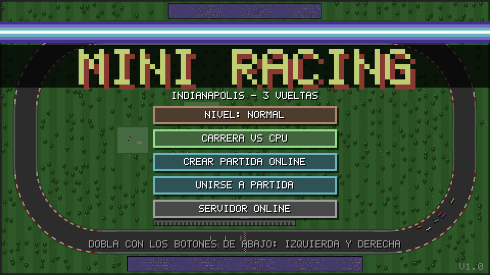
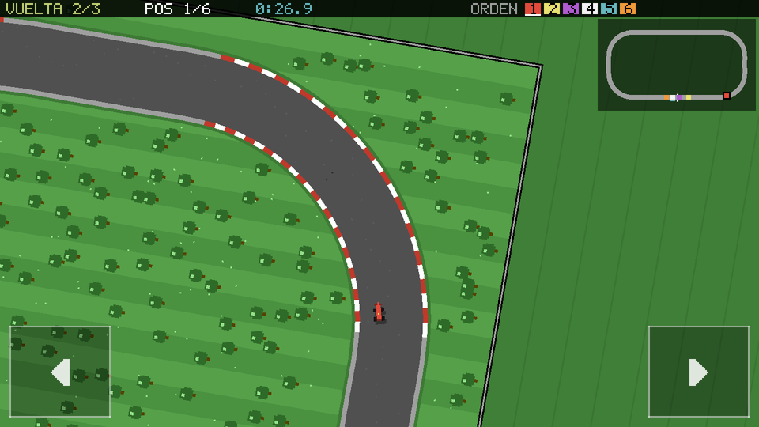
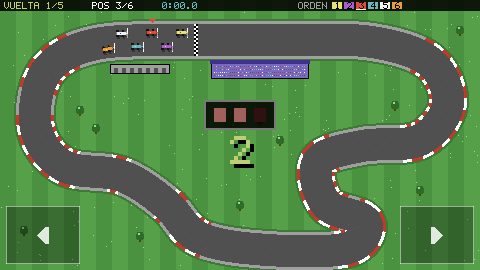
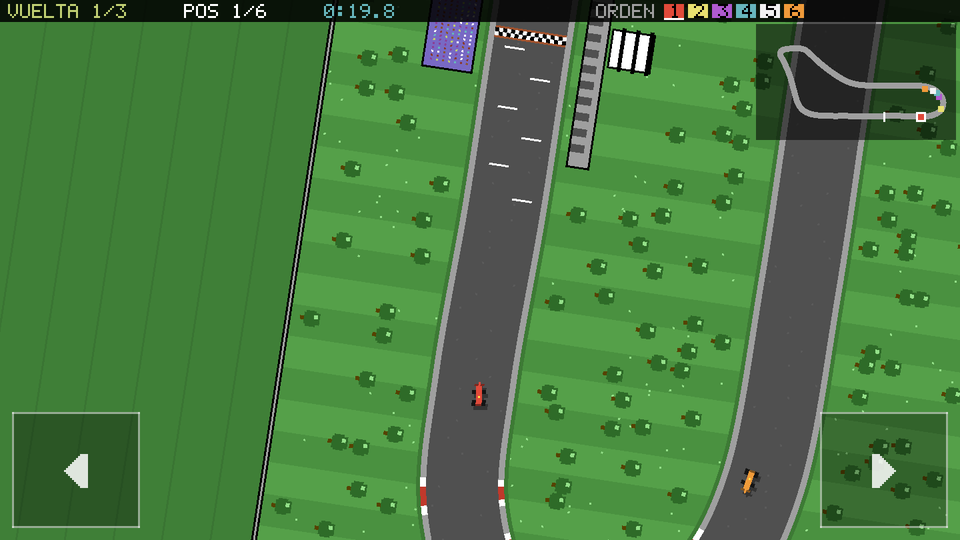

# Mini Racing 🏎️

Juego de carreras retro de autitos tipo Fórmula 1 para Android, inspirado en los
juegos de Commodore 64. Vista desde arriba con la cámara siguiendo a tu auto,
6 autos, 3 vueltas, en un óvalo tipo Indianápolis o en Monza. Hecho con **Godot 4.3**
(renderer GL Compatibility).

 
 

## Descargar el APK

Cada push compila el APK automáticamente con GitHub Actions:

1. Entrá a la pestaña **Actions** del repositorio → workflow **Build Android APK**.
2. Abrí la última ejecución con ✅ verde.
3. Abajo, en **Artifacts**, descargá **MiniRacing-debug-apk** (es un `.zip` con
   `MiniRacing-debug.apk` adentro).
4. Pasá el APK al celular e instalalo (hay que permitir "instalar apps de
   orígenes desconocidos"). Es un APK *debug* firmado con una clave de
   depuración: sirve para probar, no para publicar en Play Store.

## Pistas y cámara

En el menú, el botón **< PISTA: ... >** cambia entre:

- **INDIANAPOLIS**: un óvalo con las proporciones del real (dos rectas largas,
  dos rectas cortas y cuatro curvas iguales de 90°), en sentido antihorario,
  como allá. Tribunas afuera de las rectas, boxes y torre de cronometraje en
  la recta principal, ladrillos en la línea de llegada y una cancha de golf
  adentro.
- **MONZA**: Monza sin chicanas, en sentido horario: Curva Grande, Lesmo,
  Ascari, la recta de atrás y una Parabólica amplia, todo dentro del bosque
  del parque. Tiene curvas donde hay que levantar.

La pista elegida se guarda en el celular. En online la elige quien **crea** la
partida. Las dos están rodeadas por un alambrado que hace de pared.

Las pistas son el **doble de grandes que la pantalla**, así que la cámara sigue a
tu auto y **gira con él**: tu auto siempre apunta hacia arriba y ves la curva
que viene. La cámara sigue hacia dónde avanza el auto (no hacia dónde apunta
la trompa), y gira suavemente para que un derrape o un choque no sacudan la
pantalla. Arriba a la derecha hay un **minimapa** con toda la pista y un punto
por auto (el tuyo titila).

## Nivel de dificultad

En el menú, el botón **NIVEL** cambia la velocidad de los autos de la CPU:

- **FACIL**: los CPU van bastante más despacio y frenan más en las curvas.
- **NORMAL** (por defecto): carrera pareja.
- **DIFICIL**: los CPU a fondo (como en la primera versión).

El nivel se guarda en el celular. En online lo elige quien crea la partida.

## Cómo se juega

- Los autos **aceleran solos**. Vos solo doblás.
- Un botón táctil **abajo a la izquierda** (doblar a la izquierda) y otro
  **abajo a la derecha** (doblar a la derecha); en la PC: flechas o A/D. Toda
  la mitad izquierda o derecha de la pantalla responde, no hace falta acertarle
  justo al botón.
- Al soltar, el auto sigue derecho.
- Si doblás a fondo una curva cerrada a toda velocidad, el auto **derrapa**,
  deja marcas de goma y pierde velocidad.
- En el **pasto** el auto pierde mucha velocidad; al volver al asfalto
  recupera de a poco.
- Los autos se chocan y se empujan (cambian trayectoria, velocidad y giran),
  pero nunca se destruyen. Si un auto queda trabado varios segundos, vuelve
  solo a la pista.
- HUD: vuelta, posición, tiempo, orden de carrera (cuadraditos de colores) y
  ping en modo online. Aviso de "CONTRAMANO" si vas al revés.

### Rivales CPU

| Nombre  | Personalidad                                           |
|---------|--------------------------------------------------------|
| RAYO    | Rápido y arriesgado: más velocidad punta, entra pasado a las curvas |
| PRECISO | Preciso en las curvas: usa la línea ideal y frena justo |
| TORO    | Agresivo en los adelantamientos: se tira cerca y no le importa tocar |
| CALMO   | Equilibrado |

En **CARRERA VS CPU** jugás vos + 4 CPU + un sexto auto ("BOT") que ocupa el
lugar del segundo jugador humano. La carrera es a **3 vueltas**.

## Multijugador online

Arquitectura: **servidor autoritativo** escrito en Godot (el mismo proyecto,
corriendo en modo headless). Los celulares se conectan por **WebSocket**
(funciona por internet, no depende de estar en la misma Wi-Fi).

- **CREAR PARTIDA ONLINE** → el servidor crea una sala y muestra un
  **código de 4 dígitos**.
- El otro jugador entra a **UNIRSE A PARTIDA** y escribe el código.
- Cuando entra el segundo jugador la carrera arranca sola: 2 humanos + 4 CPU.
- El servidor simula toda la carrera (física, CPU, choques, vueltas,
  posiciones) a 60 Hz y manda el estado a los dos celulares 30 veces por
  segundo. Cada celular solo manda su dirección (izquierda/derecha).
- El cliente predice su propio auto para que el manejo responda al instante
  y corrige suavemente con lo que dice el servidor; los demás autos se
  interpolan.
- Al final los dos ven **la misma clasificación** (la calcula el servidor).
  **OTRA VEZ** pide revancha; arranca cuando los dos la piden.
- Si un jugador se desconecta, su auto pasa a manejarlo la computadora y el
  otro puede terminar la carrera.

### Paso 1: desplegar el servidor (una sola vez)

El servidor necesita estar en internet. La opción más simple y gratuita es
**Render**:

1. Creá una cuenta en <https://render.com> y conectá tu GitHub.
2. **New → Blueprint** → elegí este repositorio. Render lee `render.yaml`
   y crea el servicio `mini-racing-server` usando el `Dockerfile`.
   (Alternativa manual: **New → Web Service** → este repo → Runtime
   **Docker**, plan Free.)
3. Cuando termine, Render te da una URL tipo
   `https://mini-racing-server-xxxx.onrender.com`.
4. La URL para el juego es la misma pero con **`wss://`**:
   `wss://mini-racing-server-xxxx.onrender.com`

> Nota: en el plan gratis de Render el servidor "se duerme" tras 15 minutos
> sin uso; la primera conexión puede tardar ~1 minuto en despertarlo
> (el juego espera hasta 45 s y se puede reintentar).

Otras opciones: cualquier VPS o servicio que corra Docker
(Railway, Fly.io, Oracle Cloud, una PC en casa con el puerto abierto):

```bash
docker build -t mini-racing-server .
docker run -d -p 9080:9080 --restart unless-stopped mini-racing-server
# URL para el juego: ws://IP-DEL-SERVIDOR:9080
```

Sin Docker, con Godot 4.3 instalado:

```bash
godot --headless --path . -- --server --port=9080
```

### Paso 2: decirle al juego dónde está el servidor

Dos formas (los dos jugadores tienen que usar el mismo servidor):

- **En el juego**: menú → **SERVIDOR ONLINE** → escribir la URL `wss://...`
  → **GUARDAR Y PROBAR**. Queda guardada en el celular.
- **En el APK** (recomendado, así nadie tiene que escribir nada): en GitHub,
  **Settings → Secrets and variables → Actions → Variables → New repository
  variable**, nombre `MINI_RACING_SERVER_URL`, valor `wss://...`. El próximo
  APK que compile Actions ya viene con esa URL por defecto.

## Desarrollo

```
scenes/        escenas (menu, race, lobby, settings, server)
scripts/
  track.gd       las pistas (mundo de 960x540, spline, curvatura, grilla de largada)
  race_sim.gd    simulación compartida: física arcade, IA, choques, vueltas
  race.gd        pantalla de carrera: cámara, HUD, minimapa, controles, predicción online
  server.gd      servidor autoritativo con salas
  net_client.gd  cliente WebSocket
  menu.gd, lobby.gd, settings.gd   pantallas
  track_view.gd, car_sprites.gd, pixel_font.gd, palette.gd, ui.gd, sfx.gd
tests/
  run_tests.gd        tests headless (carreras completas + online por WebSocket)
  net_client_check.gd prueba de un servidor ya desplegado
```

Correr los tests:

```bash
godot --headless --editor --path . --quit   # importar una vez
godot --headless --path . --script res://tests/run_tests.gd
```

Probar un servidor desplegado:

```bash
godot --headless --path . --script res://tests/net_client_check.gd -- --url=wss://tu-servidor.onrender.com
```

### CI

- `.github/workflows/android.yml`: descarga Godot 4.3 y los templates de
  exportación (solo Android), instala `platform-tools`, `build-tools;34.0.0`
  y `platforms;android-34` con el `sdkmanager` del runner, crea la keystore
  de depuración, escribe `editor_settings-4.3.tres` (Godot 4.3 usa ese nombre;
  por eso antes la ruta del SDK quedaba vacía), importa el proyecto, corre los
  tests, exporta el APK, lo verifica con `apksigner` y lo sube como artifact.
- `.github/workflows/server.yml`: construye la imagen Docker del servidor, la
  levanta y conecta dos clientes de prueba que crean y se unen a una sala.
